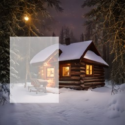
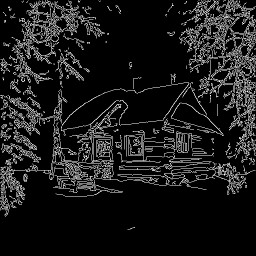
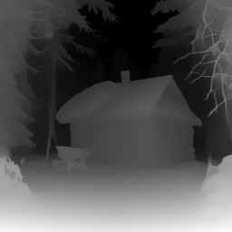
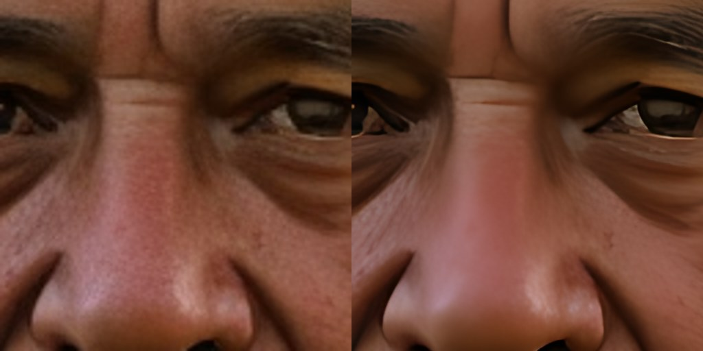
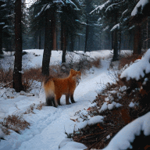
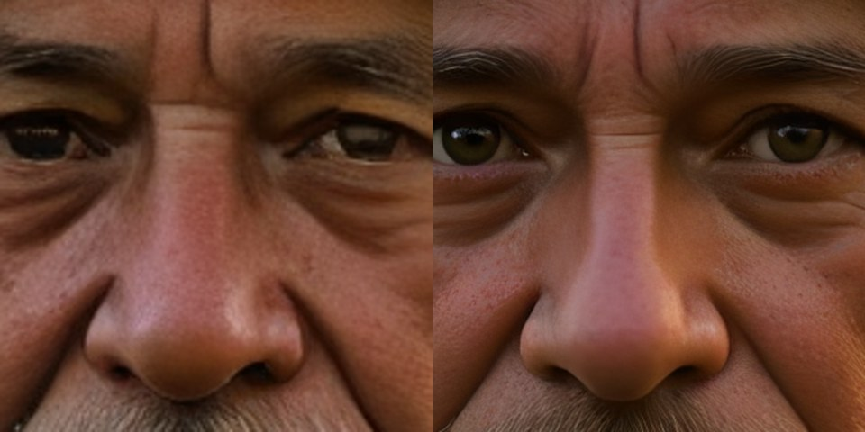

# NeuraCraft

A small, dependency-free neural network library written from scratch in C++17:
dense, convolutional and transformer layers with hand-written backpropagation,
losses, optimizers, data and text utilities, a multi-threaded SIMD CPU backend,
Apple Accelerate and Metal GPU support — plus demos (MNIST, a GPT trained from
scratch, and OpenAI's pretrained GPT-2 running on the library's own layers)
and a gradient-checked test suite.

## Build and run

Requires CMake ≥ 3.16 (3.20+ for `ctest --test-dir`) and a C++17 compiler
(GCC, Clang or Apple Clang). On macOS the Accelerate and Metal backends are
built automatically; no other dependencies.

```
$ ./build_and_run.sh            # XOR, spiral and sine demos
$ ./build_and_run.sh spiral     # a single demo
$ ./build_and_run.sh --test     # unit tests + demos via ctest
$ ./build_and_run.sh bench      # matrix-multiply speed of every backend
$ ./build_and_run.sh --gpu spiral   # run large products on the GPU
```

Or with CMake directly:

```
$ cmake -S . -B build -DCMAKE_BUILD_TYPE=Release
$ cmake --build build --parallel
$ ctest --test-dir build --output-on-failure
$ ./bin/NeuraCraft help
```

### MNIST

```
$ scripts/download_mnist.sh data/mnist
$ ./build_and_run.sh mnist data/mnist 5     # 5 epochs
```

Trains a 784-128-64-10 ReLU network with dropout and Adam, reports validation
accuracy on the 10k test set every epoch and saves the weights to
`data/mnist/mnist.weights`.

Reference run (10 epochs, seed 42): **97.97 % test accuracy**. With the v1.0
single-threaded kernel an epoch took ~7 s; the current backends take ~2.3 s on
the same 2-core machine (see below).

| epoch | train loss | train acc | test loss | test acc |
|---:|---:|---:|---:|---:|
| 1 | 0.3162 | 90.75 % | 0.1399 | 95.94 % |
| 2 | 0.1429 | 95.71 % | 0.0950 | 96.98 % |
| 4 | 0.0894 | 97.22 % | 0.0704 | 97.74 % |
| 6 | 0.0702 | 97.75 % | 0.0712 | 97.81 % |
| 8 | 0.0536 | 98.26 % | 0.0631 | 98.04 % |
| 10 | 0.0469 | 98.39 % | 0.0696 | 97.97 % |

A convolutional network (2× Conv3×3 + MaxPool, then Dense) does better:

```
$ ./build_and_run.sh mnist data/mnist 3 cnn   # -> data/mnist/mnist_cnn.weights
$ ./build_and_run.sh eval data/mnist cnn      # reload, per-digit accuracy, show mistakes
```

| model | parameters | epochs | test accuracy | time / epoch (2-core x86) |
|---|---:|---:|---:|---:|
| MLP 784-128-64-10 | 109 k | 3 | 97.10 % | 2.3 s |
| CNN 16-32 conv + 128 dense | 207 k | 3 | 98.83 % | 46 s |

### Language model (GPT)

```
$ scripts/download_shakespeare.sh                     # data/shakespeare.txt (1.1 MB)
$ ./build_and_run.sh gpt data/shakespeare.txt 2       # BPE tokens (default)
$ ./build_and_run.sh gpt data/shakespeare.txt 2 char  # character tokens
$ ./build_and_run.sh gpt data/shakespeare.txt 3 --resume   # 3 more epochs from the checkpoint
$ ./build_and_run.sh gpt data/shakespeare.txt 6 --cosine --dim 192 --layers 6 --heads 6 --context 128
$ ./build_and_run.sh generate data/shakespeare.txt "ROMEO:" 200
```

`gpt` trains a decoder (default: 4 layers, 4 heads, dim 128, context 64
tokens, modern architecture) on any text file, prints a sample after every epoch and saves
`<file>.gpt.weights`, `.gpt.config`, `.gpt.tokenizer` and a
`.gpt.checkpoint` (weights + Adam state + step + random state, written after
every epoch); `generate` rebuilds the model from the config and samples with
temperature 0.8, top-k 20. Training clips the global gradient norm to 1;
`--cosine` adds linear warmup and cosine decay of the learning rate over the
whole run (`--lr` is the peak). For a short run a constant rate is better:
over 2 epochs it reaches 1.817 per character, cosine 1.894 (peak 1e-3) or 1.842
(peak 2e-3), because the rate decays before the model has learned enough.
Over 6 epochs the picture flips: cosine with peak 2e-3 ends at **1.589**,
the constant rate at 1.604.

Two architectures are available (`--arch`):

| | classic (GPT-2) | modern (Llama-style, default) |
|---|---|---|
| positions | learned table | rotary (RoPE) in attention |
| normalization | LayerNorm | RMSNorm |
| MLP | GELU, 4× wide | SwiGLU, same parameter count |
| output layer | separate | tied to the embedding |
| parameters (BPE 512) | 0.93 M | 0.86 M |
| val loss / char after 2 epochs | 1.817 | **1.713** |
| time / epoch | 86 s | 79 s |

With RoPE, attention scores depend only on relative distance, so the KV
cache can simply slide once the context is full (sliding-window attention, as
in Mistral). For a single layer that is identical to recomputing the last 64
tokens; deeper layers also carry information from beyond the window. Measured
on the trained model over 1136 tokens past the window, mean next-token loss is
3.1048 sliding vs 3.1046 recomputing (and 3.0973 when rebuilding from the
last half window), so the O(1) sliding cache costs nothing in quality. Models
with learned positions rebuild the cache from its last half instead. `--resume` continues from the checkpoint, and a resumed run
is bit-for-bit identical to one that never stopped; asking for more epochs
than originally planned stretches the cosine curve from that point. The default tokenizer is byte-level BPE with 512
tokens (learned from the file in under a second); `char` uses one token per
character. Validation loss is also reported per character, so the two are
comparable.

Tiny Shakespeare, 2 epochs, 2-core x86 sandbox:

| tokenizer | chars / token | parameters | time | val loss per character |
|---|---:|---:|---:|---:|
| char (65) | 1.00 | 0.82 M | 487 s | 1.911 |
| BPE (512) | 1.92 | 0.93 M | **259 s** (one epoch now takes 86 s, see Performance) | **1.817** |

BPE sees about twice as much text in the same 64-token context and needs half
the steps per epoch, so it is both better and faster here.

Generation uses a **KV cache**: every attention layer keeps the keys and
values of earlier positions, so each new token runs alone through the network
instead of re-processing the whole window. On the model above that is
**~1170 tokens/s instead of ~130** (9×), with identical output while the text
fits in the context window. When the window fills up, the cache is rebuilt
from its most recent half (positions are learned absolute embeddings, so the
window cannot simply slide); pass no context to `generate()` for the exact
sliding-window behaviour. Samples already
have the play's structure (speaker names, verse lines) with partly invented
words; more epochs or a wider model improve them:

```
JULIET:
O, I belure you'er frilince, beless, they are. Venount?

QUEEN MARGARET:
Whoppleack, Vposed, he is hered armporire.
```

Building one yourself:

```cpp
BpeTokenizer tok = BpeTokenizer::train(text, 512);    // or CharTokenizer tok(text);
Dataset d = makeNextTokenDataset(tok.encode(text), 64);  // x, y: (sequences x 64) ids

GPTConfig cfg;
cfg.vocabSize = tok.vocabSize();
cfg.contextLength = 64;
cfg.dim = 128; cfg.heads = 4; cfg.layers = 4;
Network net;
auto ctx = buildGPT(net, cfg);       // (batch x seq) ids -> (batch*seq x vocab) logits

SparseSoftmaxCrossEntropy loss;      // targets: next-token ids, any shape
Adam opt(1e-3f);
net.fit(d.x, d.y, loss, opt);

SamplingOptions s; s.temperature = 0.8f; s.topK = 20;
std::string out = tok.decode(generate(net, tok.encode("ROMEO:"), 200, cfg.contextLength, s, ctx));  // ctx: KV cache
```

### Pretrained GPT-2

```
$ scripts/download_gpt2.sh data/gpt2      # 124M-parameter GPT-2 from Hugging Face (~550 MB)
$ ./build_and_run.sh gpt2 data/gpt2 "Once upon a time, in a small village by the sea," 120
$ ./build_and_run.sh gpt2 data/gpt2 "The meaning of life is" 20 --check
```

`gpt2` loads OpenAI's GPT-2 weights (`model.safetensors`) and tokenizer
(`vocab.json` + `merges.txt`) into the library's own layers and streams a
sampled continuation (temperature 0.8, top-k 40; `--greedy`,
`--temperature`, `--top-k` change that). Larger GPT-2 checkpoints
(gpt2-medium, -large, -xl) load the same way.

It matches the reference implementation exactly: `scripts/gpt2_reference.py`
is an independent NumPy GPT-2 (no shared code). For the prompt above both
print the same token ids, top-5 logits and greedy continuation (*"The meaning
of life is not the same as the meaning of death. …"*); over a 55-token mixed
English/Turkish/emoji/code prompt all 55 × 50257 logits agree within
1.1e-4 with the same argmax at every position. The tokenizer produces the
same ids as Hugging Face `tokenizers` on 20 tricky inputs (contractions,
whitespace runs, Turkish, CJK, emoji, code, symbols).

`--int8` converts the weights to 8-bit integers after loading (one float
scale per 64 inputs of every output, so a single outlier cannot coarsen a
whole row). Generation is memory-bandwidth bound — every token reads all the
weights — so a quarter of the bytes is much faster, at almost no cost:

| GPT-2 124M, 2-core x86 | float32 | int8 |
|---|---:|---:|
| generation | 15.5 tokens/s | **39 tokens/s** |
| perplexity (4096 Shakespeare tokens) | 106.8 | 107.3 (+0.5 %) |
| greedy continuation above | — | identical |

(With one scale per row instead of per 64 inputs, perplexity rose 4.2 %.)
The `gpt2` command keeps GPT-2's activations in float (`setInt8Inputs(false)`):
its activations have extreme outliers, and quantizing them too moved
perplexity by -3.7 % instead of +0.5 %.
Loading takes 1.5 s: layers are built without allocating weights or gradient
buffers (`SkipParameterInit`), and the checkpoint fills them directly.

### Llama family (Llama 3.x, TinyLlama, Llama 2, Mistral)

```
$ scripts/download_llama32.sh data/llama3        # Llama-3.2-1B-Instruct (~2.5 GB bf16)
$ ./build_and_run.sh llama data/llama3 "What is the capital of Turkey?" --chat
$ ./build_and_run.sh llama data/llama3 -i                     # multi-turn chat (/reset, /exit)
$ scripts/download_tinyllama.sh data/tinyllama   # TinyLlama-1.1B-Chat (Apache 2.0, ~2.2 GB bf16)
$ ./build_and_run.sh llama data/tinyllama "Write a haiku about Istanbul." 64 --chat --system "You are a poet."
$ ./build_and_run.sh llama data/llama3 "What is the capital of Turkey?" 20 --chat --check --fp32
```

`llama` loads a Hugging Face Llama-architecture checkpoint (`config.json`,
`model.safetensors` or a sharded `model.safetensors.index.json`,
`tokenizer.json`, and `generation_config.json` for the stop tokens) into the
same layers as the modern GPT: RMSNorm, rotary attention with grouped-query
heads (Llama 3.2 1B: 32 query heads sharing 8 key/value heads), SwiGLU and a
tied or untied output head. Llama 3.1+'s `"rope_type": "llama3"` frequency
scaling is applied (`RopeScaling`, `ropeFrequencies()`).

Sampling follows the model's `generation_config.json` (Llama 3.2: temperature
0.6, top-p 0.9) with top-k 40; `--temperature`, `--top-k`, `--top-p`,
`--repeat-penalty`, `--greedy` and `--seed` override it. `-i` keeps one
conversation going: a `Generator` holds the KV cache between turns, so each
turn only runs the new message through the model.

`--chat` picks the model's template: Llama 3's header/`<|eot_id|>` turns
(with the knowledge-cutoff/today system preamble Hugging Face renders) or
the Zephyr `<|system|>`/`<|user|>`/`<|assistant|>` turns of TinyLlama-Chat.
Generation stops at any of the model's end-of-turn ids.

`LlamaTokenizer` reads both kinds of `tokenizer.json`: SentencePiece style
(Llama 2, TinyLlama, Mistral: `▁` normalizer, byte fallback) and byte-level
BPE (Llama 3: the Llama 3 split pattern implemented by hand over full Unicode
letter/number tables, `ignore_merges`). Special tokens are split out first.
It gives the same ids as Hugging Face `tokenizers` on 34 tricky inputs for
Llama 3 (contractions in any case, digit runs, whitespace and line-break
runs, Turkish, CJK, Devanagari, Arabic, emoji sequences, code, the chat
template) and 51 for TinyLlama.

Weights are int8 by default (`--fp32` keeps float32), including the
embedding table, whose int8 copy also serves a tied output; each tensor is
quantized as it is read, so the float copy of the whole model never exists.
Products run on integers: activations are quantized per 32 values (as
llama.cpp's q8_0) and each group is an int8 dot product — AVX-VNNI
`vpdpbusd` (or AVX2 `vpmaddubsw`) on x86, `sdot` on Apple silicon and other
ARMv8.2+ CPUs, plain C++ elsewhere. Weight rows are prefetched 4 KB ahead,
which took the kernel from 11 to ~20 GB/s on a machine that streams memory at
~23 GB/s, and prompts process four weight rows per pass over the input.
From 256 rows on (long prompts, image models) tiles of weights are expanded to
float for the float GEMM instead, which is faster there and keeps the
activations exact.
`scripts/llama_reference.py` is an independent NumPy Llama: with `--fp32
--check` both print the same token ids, top-5 logits and greedy answer
(*"The capital of Turkey is Ankara."*), and over a mixed 42-token prompt all
42 × 128256 Llama 3.2 logits agree within 2.9e-5 (TinyLlama: 54 × 32000
within 3e-5).

| 2-core x86, int8 / float32 | Llama 3.2 1B | TinyLlama 1.1B |
|---|---:|---:|
| memory (peak RSS) | **1.6** / 5.9 GB | **1.5** / 4.8 GB |
| generation (160-token chat answer, incl. prompt) | **11.5** / 2.3 tokens/s | **13.9** / 2.3 tokens/s |
| one token / prompt processing | 13 / 33 tokens/s | — |
| loading (bf16 checkpoint) | 12 / 35 s | 12 / 35 s |
| perplexity, 1024 Shakespeare tokens | 35.090 / 35.088¹ | 13.277 / 13.264 |
| greedy answers above | identical | identical |

int8 generation was 3.6 and 4.5 tokens/s before the integer kernels (weights
expanded to float per row). The perplexity windows (256 / 512 tokens) take the
expanded-weights path; with the activations quantized as well (the token-by-
token path) they are 35.131 and 13.269, so the q8_0 activations cost 0.1 % on
Llama 3.2.

¹ 256-token windows (512 for TinyLlama). The float32 value comes from the
NumPy reference, whose logits match NeuraCraft's float32 ones to 3e-5: a
float32 Llama 3.2 plus a 256-token pass does not fit in this machine's memory.

Not supported yet (the loader refuses them with a message): other RoPE
scaling types (linear, dynamic, YaRN), attention biases (Qwen 2; its
tokenizer pattern is supported), sliding-window attention (Mistral v0.1) and
tokenizer.json files with other pre-tokenizers (e.g. Metaspace).

### Image and video workflows at a glance

| Task | Command | Model(s) | Script |
|---|---|---|---|
| Text to image | `txt2img` | SD-Turbo (1 step), any SD 1.5 (+ LCM-LoRA: 4 steps) | `download_sd_turbo.sh`, `download_lcm_lora.sh` |
| Image to image | `img2img` | same | |
| Inpainting | `inpaint` | SD 1.5 inpainting | `download_sd_inpaint.sh` |
| Structure control | `--controlnet DIR --control pic --canny` | ControlNet 1.1 (SD 1.5) | `download_controlnet.sh` |
| Prompt morph / infinite zoom | `video DIR morph` / `zoom` | SD-Turbo | |
| Outpaint zoom | `video DIR outpaint` | SD 1.5 inpainting | |
| Text / image / video to video | `video DIR t2v` (`--init`, `--init-dir`, `--prompt-at`) | SD 1.5 + AnimateDiff-Lightning or AnimateLCM | `download_animatediff.sh` |
| Image prompt (style / subject from a picture) | `--ip-adapter file --image-prompt pic` | IP-Adapter SD 1.5 | `download_ip_adapter.sh` |
| Style / speed adapters | `--lora file[:scale]`, `--sampler lcm` | kohya / PEFT LoRA files | |
| Depth map / 3D photo | `depth`, `parallax`, `--depth-model` | Depth Anything V2 Small | `download_depth_anything.sh` |
| Upscale x4 | `upscale`, `video --upscale` | Real-ESRGAN compact | `download_upscaler.sh` |
| Smoother motion | `interpolate`, `video --interpolate` | RIFE v4 | `download_rife.sh` |
| Chains of the above | `workflow steps.json` | | `docs/workflows/` |
| Output | `.png` `.jpg` / `.gif` `.png` (APNG) `.mov` | | |

### Text to image: Stable Diffusion (SD-Turbo)

```
$ scripts/download_sd_turbo.sh data/sd-turbo                  # SD-Turbo, fp16 (~2.6 GB) + TAESD
$ ./build_and_run.sh txt2img data/sd-turbo "A cinematic photo of a red fox sitting in the snow, golden hour" fox.png --seed 42
$ ./build_and_run.sh txt2img data/sd-turbo "The Istanbul skyline at sunset, oil painting" ist.png --steps 2 --seed 7
$ ./build_and_run.sh txt2img data/sd-turbo "A watercolor lighthouse" l.png --tiny-vae data/sd-turbo/taesd   # 10x faster decode
$ ./build_and_run.sh img2img data/sd-turbo fox.png "a white arctic fox in the snow" arctic.png --tiny-vae data/sd-turbo/taesd
$ ./build_and_run.sh vae data/sd-turbo photo.ppm out.png      # the autoencoder alone: encode + decode
```

<p> </p>

Both pictures above were generated by NeuraCraft on a 2-core CPU from the
prompts shown (1 and 2 steps). `textToImage()` runs the whole Stable Diffusion
pipeline on a diffusers directory, loading each model only for its stage.
The UNet and the text encoder use int8 weights by default (`--fp32` keeps
float32): every convolution and linear layer is quantized as soon as it is
loaded, small feature maps use the integer kernels and large ones expand
weight tiles for the float GEMM. The picture stays the same (32 dB PSNR
against float32, no visible difference) at 40 % of the memory:

| SD-Turbo, 512 x 512, 2-core x86, `--tiny-vae` | float32 | int8 (default) |
|---|---:|---:|
| peak memory | 3.5 GB | **1.4 GB** |
| CLIP text encoder (load + encode) | 4.8 s | 7.2 s |
| UNet: load / one denoising step | 14.5 s / 14.5 s | **8.5 s / 12.2 s** |
| TAESD decode (full VAE: 50 s) | 5.4 s | 5.4 s |
| total for one image (1 step) | 39 s | **33 s** |

**Image to image** (`imageToImage()`, `img2img`): the input (PNG or PPM) is
cropped and resized to the output size, encoded, noised to the sigma of step
`steps - steps * strength` and denoised for the remaining steps with the
prompt, as diffusers does; SD-Turbo's setting is 2 steps at strength 0.5, one
UNet pass. Below, the fox picture turned into an arctic fox (48 s, TAESD):

<p></p>

The PNG reader has its own inflate (stored, fixed and dynamic Huffman blocks)
and handles grey, grey + alpha, RGB, RGBA and palette images (1- to 16-bit);
it decodes Pillow's files of all those kinds to identical pixels.
`resizeImage()` (bilinear, box-filtered when shrinking) and `fitImage()`
(centred crop to the aspect ratio) prepare inputs.

Pieces, each checked against an independent NumPy implementation (`scripts/`):

- **Prompt:** `ClipTokenizer` (CLIP's lowercased byte-level BPE with `</w>`
  word ends; same ids as transformers' `CLIPTokenizer` on 20 prompts, including
  SD 2's quirk of turning every "!" into the pad token) and
  `loadClipTextEncoder()` (Hugging Face `CLIPTextModel` on the GPT layers;
  `GELU` has erf and "quick" modes). SD-Turbo's 23-layer OpenCLIP ViT-H text
  model agrees with `clip_reference.py` within 7.9e-6.
- **Denoiser:** `loadUNet()` builds diffusers' `UNet2DConditionModel` (SD 1.x /
  2.x / Turbo layouts: time-conditioned residual blocks, spatial transformers
  with self- and cross-attention and GEGLU, skip connections); 866 M parameters,
  within 2.5e-6 of `unet_reference.py`. `multiHeadAttention()` processes
  queries in chunks, so 4096-pixel self-attention needs no 4096 x 4096 matrix
  per head. `EulerScheduler` follows diffusers' `EulerDiscreteScheduler`
  (scaled-linear betas; trailing, leading or linspace spacing).
  Classifier-free guidance (`--guidance`, `--negative`) is there for non-Turbo
  models.
- **Image:** `loadVae()` builds the KL autoencoder (`AutoencoderKL`) from the
  new image layers in `Image.h` (`GroupNorm`, `SiLU`, `Upsample2D`, `Pad2D`,
  `ResnetBlock2D`, `SpatialSelfAttention`) and `Conv2D`, whose inference path
  works in row strips written straight into channel-major output (memory
  stays bounded at 512 x 512; 1x1 convolutions are one GEMM). It agrees with
  `vae_reference.py` within 5.4e-6; an encode/decode round trip keeps a
  picture at 29-32 dB PSNR. PNG and JPEG output, PNG and PPM input are built in.
- **Preview decoder:** `loadTinyVae()` builds TAESD (diffusers
  `AutoencoderTiny`, madebyollin/taesd, ~1 M parameters: 3x3 convolutions,
  ReLU residual blocks); decoding a 512 x 512 latent takes 4.8 s instead of
  50 s and looks nearly the same (fine textures soften a little). Decoder and
  encoder agree with `taesd_reference.py` within 5e-6 / 1e-5.
  `textToLatent()` and `decodeLatent()` expose the two halves of the pipeline.

The full VAE decoder (~2.5 TFLOP at 512 x 512) is the slowest stage on a CPU;
on Apple silicon the products go to Accelerate. Loading got faster with a
tiled, parallel `Matrix::transpose` (0.3 -> 1.2 GB/s; UNet load 28 -> 16 s).

### Animation: prompt morphs and infinite zoom

```
$ ./build_and_run.sh video data/sd-turbo morph "a cozy cabin in a snowy forest at night, warm lights, photo" \
      "a cozy cabin in a spring forest with blooming flowers, photo" "a cozy cabin in an autumn forest, golden leaves, photo" \
      --seeds 3 --frames 8 -o cabin.gif
$ ./build_and_run.sh video data/sd-turbo zoom "an ancient city of towers in the clouds, fantasy painting" \
      --frames 24 --zoom 1.04 -o city.gif --frames-dir city/      # also PNG frames (+ the ffmpeg line for an MP4)
```

<p> </p>

`StableDiffusion` keeps the tokenizer, text encoder, UNet and decoder in
memory, so an animation pays the model loading once and then one UNet pass
per frame (TAESD decodes automatically when `DIR/taesd` exists;
`--full-vae` opts out). Two animation modes are built on it:

- **Morph** (`morphAnimation()`): the prompts are keyframes. Between two of
  them the text encoder's hidden states are interpolated linearly and the
  starting noise spherically (slerp keeps it a plausible Gaussian sample),
  with smoothstep easing so each keyframe holds for a moment; every frame is
  a one-step SD-Turbo picture of its interpolated pair, and the keyframes are
  exactly the pictures `txt2img` gives for them. One seed with several
  prompts changes the subject in place; several seeds with one prompt wander
  through compositions.
- **Zoom** (`zoomAnimation()`, Deforum style): each frame is the previous one
  moved (`transformImage()`: zoom, pan, rotation), sharpened, given a little
  pixel noise and redrawn with image to image over two of the timesteps
  SD-Turbo was distilled at (499 and 249; one pass from 249 alone keeps frames
  closer but cannot invent the detail zooming needs, and the picture flattens
  into blocks after a dozen frames). Each channel's histogram is matched to
  the first frame's, so the feedback loop does not drift to other hues. Several prompts are spread over the
  frames; `--start in.png` begins from your own picture.

`saveGif()` writes the animated GIF itself: one 256-colour palette for all
frames (median cut over every frame, so colours do not flicker), a fixed 4x4
ordered dither (no crawling error-diffusion patterns) and LZW compression;
Pillow and ffmpeg decode it, and the tests decode it with their own LZW
reader. On the 2-core test machine a 512 x 512 frame takes ~15 s (morph) and
~35 s (zoom: TAESD encode, two UNet passes, decode); at 256 x 256, 3.5 s, though
SD-Turbo's pictures are best at its native 512. The animations above are
512 x 512 runs shown at half size.

### Text to video: AnimateDiff-Lightning

```
$ scripts/download_animatediff.sh data/animatediff     # epiCRealism (SD 1.5), AnimateDiff-Lightning 4-step, TAESD (~4.7 GB)
$ ./build_and_run.sh video data/animatediff t2v "a corgi running on the beach, golden hour, photo" --frames 16 --seed 1
```

<p></p>

Real motion instead of redrawn frames: `textToVideo()` adds an AnimateDiff
motion adapter to a Stable Diffusion 1.5 UNet and denoises all frames
together. `loadMotionModules()` reads diffusers `MotionAdapter` files
(AnimateDiff v2, AnimateDiff-Lightning) and puts a temporal transformer after
every resnet / attention of the down, mid and up blocks: GroupNorm over all
frames, sinusoidal frame positions, two self-attention layers in which each
pixel's frames attend to each other, a GEGLU feed-forward.
`UNet2DCondition::forwardFrames()` runs the spatial layers frame by frame and
the motion modules across frames, in pixel chunks so memory stays bounded.
ByteDance's AnimateDiff-Lightning is distilled for 1, 2, 4 or 8 steps
(Euler, linear betas, trailing timesteps, no guidance), so a 16-frame clip
takes 4 UNet passes over 16 frames. `scripts/animatediff_reference.py` (NumPy)
agrees with it within 3e-6 on a synthetic model; with the real int8 weights
the predicted noise correlates 0.9998 with the float32 reference.
On the 2-core test machine the clip above (16 frames, 512 x 512, 4 steps,
int8) took 20 minutes: 4.4 minutes per denoising step over all 16 frames,
87 s of TAESD decoding, 2.2 GB peak memory. AnimateDiff v1 modules (no mid block module)
are refused; any SD 1.5 model in diffusers layout can replace epiCRealism.

**Longer clips, image to video, video to video.** More frames than the
motion module's context (`--context 16 --overlap 4`) are denoised in
overlapping windows whose predictions are blended with pyramid weights, so a
48-frame clip costs about four 16-frame windows per step. `--init still.png`
animates a picture (every frame starts from it, noised to the sigma of step
`steps - steps * strength`, default 0.75 = 3 of Lightning's 4 steps), and
`--init-dir frames/` restyles a clip frame by frame with motion kept
consistent:

```
$ ./build_and_run.sh video data/animatediff t2v "a cozy log cabin in a snowy forest at night, heavy snow falling" \
      --init cabin.png -o cabin.mov          # image to video, QuickTime output
$ ./build_and_run.sh video data/animatediff t2v "a corgi on the beach" --frames 48 -o long.png   # 4 windows, animated PNG
```

<p> </p>

Above: the snowy cabin from the morph animation (left, saved with
`saveJpeg`) animated with falling snow at strength 0.75 (right; 16 frames,
512 x 512, 17 minutes on the 2-core machine).

**Prompt travel.** `--prompt-at FRAME:prompt` (`promptAt`) adds keyframes
after the main prompt; every frame's text condition is interpolated between
the keyframes around it, and the motion module keeps the change continuous:

```
$ ./build_and_run.sh video data/animatediff t2v "a lone oak tree on a green hill, spring, blooming flowers, photo" \
      --prompt-at "31:a lone oak tree on a hill in winter, covered in snow, photo" --frames 32 --size 384
```

<p></p>

Inside one 16-frame window the motion module pulls all frames towards one
scene, so a 16-frame clip shows a blend of both prompts; over a longer clip
(32 frames above: three overlapping windows, 384 x 384, 29 minutes on the
2-core machine) the change from spring to winter comes through.

### LoRA and the LCM sampler

`--lora file.safetensors[:scale]` merges LoRA adapters
(kohya / A1111 `lora_unet_*` / `lora_te_*` and diffusers / PEFT `lora_A` /
`lora_B` files, linear and convolution layers) into the UNet and text encoder
while they load, before int8 quantization, for every image and video command
(`LoraMerger`, `TextToImageOptions::loras`). `--sampler lcm` switches to
diffusers' `LCMScheduler` (latent consistency: predict the clean latent,
re-noise to the next timestep), so an ordinary SD 1.5 model with
[LCM-LoRA](https://huggingface.co/latent-consistency/lcm-lora-sdv1-5) draws in
4 steps without guidance:

```
$ scripts/download_lcm_lora.sh data/loras
$ ./build_and_run.sh txt2img data/animatediff "portrait photo of an old fisherman, golden hour" out.jpg \
      --steps 4 --sampler lcm --lora data/loras/lcm-lora-sdv1-5.safetensors --tiny-vae data/animatediff/taesd
```

<p></p>

Above: epiCRealism + LCM-LoRA, 4 steps, TAESD, 512 x 512 (shown smaller):
4 UNet passes, 72 s in all on the 2-core machine including model loading.

The same pieces run [AnimateLCM](https://huggingface.co/wangfuyun/AnimateLCM)
(its motion module plus its LoRA, LCM sampler with linear betas):

```
$ ./build_and_run.sh video data/animatediff t2v "a red fox walking through a snowy forest, photo" \
      --motion animatelcm/diffusion_pytorch_model.fp16.safetensors \
      --lora animatelcm/AnimateLCM_sd15_t2v_lora.safetensors:0.8 --sampler lcm --steps 4 --size 384
```

<p></p>

(16 frames at 384 x 384, 4 steps: 10 minutes on the 2-core machine.)

### Inpainting and outpaint zoom

```
$ scripts/download_sd_inpaint.sh data/sd-inpaint          # SD 1.5 inpainting, fp16 (~2.1 GB) + TAESD
$ ./build_and_run.sh inpaint data/sd-inpaint cabin.png mask.png "a snowman with a red scarf in a snowy forest at night, photo" \
      out.png --steps 20 --guidance 7.5
```

<p> </p>

`StableDiffusion::inpaint()` / `inpaint()` work like diffusers'
`StableDiffusionInpaintPipeline` on a 9-channel inpainting UNet: the
masked picture is encoded, the mask is brought to latent size, and both are
fed to the UNet next to the noisy latent at every step; kept pixels are
pasted back through a feathered mask (`--feather`). Above: the cabin with
the white area of the mask (left, shown lighter) redrawn as a snowman
(20 Euler steps with guidance 7.5, 9 minutes on the 2-core machine). LoRAs
and `--sampler lcm` work here too; LCM-LoRA on this inpainting model is
faster (6 steps) but draws objects less well, which is fine for scenery.

**Outpaint zoom** (`outpaintZoom()`, `video DIR outpaint`): the classic
infinite zoom. Each keyframe is the previous one shrunk into the middle, its
new border mirrored outwards, noised and redrawn by inpainting; the frames in
between are rendered by zooming geometrically through the nested keyframes
(the sharper inner picture drawn over the outer one), so a long, smooth zoom
costs one inpainting per keyframe:

```
$ ./build_and_run.sh video data/sd-inpaint outpaint "a snowy pine forest at night with warm lights, photo" \
      --start cabin.png --keyframes 5 --shrink 0.7 --frames 16 --fps 16 \
      --steps 6 --guidance 1.8 --sampler lcm --lora data/loras/lcm-lora-sdv1-5.safetensors
```

<p></p>

(65 frames from 4 inpainted keyframes, 512 x 512: 9.5 minutes on the 2-core
machine. `--zoom-in` plays it the other way.) Starting the border from pure
noise (`--strength 1`) tends to make the model paint a frame around the old
picture; the mirrored start avoids that.

### ControlNet

```
$ scripts/download_controlnet.sh data/controlnet-canny canny     # ControlNet 1.1 canny for SD 1.5 (~720 MB)
$ ./build_and_run.sh txt2img data/animatediff "a wooden cabin in a sunny green summer meadow, photo" out.png \
      --controlnet data/controlnet-canny --control cabin.png --canny \
      --steps 4 --sampler lcm --lora data/loras/lcm-lora-sdv1-5.safetensors
```

<p>  </p>

A diffusers `ControlNetModel` directory loads with `loadUNet()` as a UNet
without up blocks: the conditioning embedding turns the control picture into
latent-size features, the copied down / mid blocks run on the noisy latent,
and zero convolutions produce residuals that `forward(..., residuals)` adds
to the UNet's skips and mid block (`controlScale` weights them).
`scripts/controlnet_reference.py` agrees with it within 2.5e-6.
`cannyEdges()` follows OpenCV's `cv2.Canny` (the ControlNet canny
preprocessor; IoU 0.99 with OpenCV's edges). Above: the snowy cabin's edges
(middle) redrawn as a summer scene, 4 LCM steps, 92 s. ControlNet works for
text to image, image to image and text / video to video (`--control-dir`, or
`--canny` alone with `--init-dir` to take the edges of the input clip).

```
$ ./build_and_run.sh video data/animatediff t2v "a golden retriever puppy standing on a beach at sunset, photo" \
      --init-dir corgi_frames/ --strength 0.75 --controlnet data/controlnet-canny --canny --control-scale 0.8 --size 384
```

<p></p>

Above: the corgi clip (left) restyled frame by frame with its own canny
edges as ControlNet input (right): the motion and outline follow the
source, the light and colours follow the prompt (16 frames at 384 x 384,
3 steps with ControlNet on every frame: 17 minutes on the 2-core machine).

### Depth: Depth Anything V2, 3D photos, depth ControlNet

```
$ scripts/download_depth_anything.sh data/depth-anything-v2-small      # ~100 MB
$ ./build_and_run.sh depth data/depth-anything-v2-small cabin.png depth.png
$ ./build_and_run.sh parallax data/depth-anything-v2-small cabin.png cabin3d.gif --frames 48
$ scripts/download_controlnet.sh data/controlnet-depth depth
$ ./build_and_run.sh txt2img data/animatediff "a bronze statue of an old fisherman with a hat, museum lighting, photo" out.png \
      --controlnet data/controlnet-depth --control fisherman.png --depth-model data/depth-anything-v2-small \
      --steps 4 --sampler lcm --lora data/loras/lcm-lora-sdv1-5.safetensors
```

<p> </p>
<p></p>

`DepthEstimator` runs Depth Anything V2 (transformers
`DepthAnythingForDepthEstimation`): a DINOv2 ViT backbone (patch embedding,
position embeddings resized bicubically for other input sizes, 12 layers
with layer scale), a DPT neck (reassemble to four scales with 1x1 convs,
transposed / strided convs, then fusion with pre-activation residual units
and bilinear upsampling) and a three-conv head. `scripts/depth_reference.py`
(NumPy) agrees within 7e-6. A 518-pixel depth map takes 3.5 s on the 2-core
machine. `parallaxAnimation()` turns a picture and its depth into a "3D
photo": near pixels sway and grow more than far ones (forward splatting with
a depth test, holes filled from the farther side); the 48-frame loop above
took 7 s including the depth map. `--depth-model` turns control pictures into
depth maps for the depth ControlNet (`control_v11f1p_sd15_depth`), here
redrawing the LCM fisherman as a bronze statue (4 LCM steps, 111 s).

### Image prompts: IP-Adapter

```
$ scripts/download_ip_adapter.sh data/ip-adapter       # adapter (~45 MB) + CLIP ViT-H image encoder (~2.5 GB)
$ ./build_and_run.sh txt2img data/animatediff "a dog in a garden, photo" out.png \
      --ip-adapter data/ip-adapter/ip-adapter_sd15.safetensors --image-prompt cabin.png --ip-scale 0.35 \
      --steps 4 --sampler lcm --lora data/loras/lcm-lora-sdv1-5.safetensors
```

<p></p>

A picture as part of the prompt: `ClipImageEncoder` (Hugging Face
`CLIPVisionModelWithProjection`, ViT-H/14, 32 layers; agrees with a NumPy
reference within 4e-7) embeds it, `IpAdapter` projects the embedding to four
context tokens, and `loadIpAdapter()` gives every cross-attention of the
UNet a second key / value projection for them, added to the text attention
with the image prompt's weight (`setImagePrompt`). Above: the cabin picture,
the prompt alone, image prompt weight 0.35 (garden, dog, the cabin and its
mood) and 0.6 (the picture takes over). It works for text and image to
image and for AnimateDiff clips (`video DIR t2v ... --ip-adapter`), where the
same tokens steer every frame; the 2.5 GB encoder is freed before the UNet
loads.

### Upscaling: Real-ESRGAN

```
$ scripts/download_upscaler.sh data/upscale              # realesr-general-x4v3 (~5 MB), converted to safetensors
$ ./build_and_run.sh upscale data/upscale/realesr-general-x4v3.safetensors photo.png photo_x4.png
$ ./build_and_run.sh video ... --upscale data/upscale/realesr-general-x4v3.safetensors    # every frame, x4
```

<p></p>

`Upscaler` runs Real-ESRGAN's compact network (`SRVGGNetCompact`: 33 3x3
convolutions with PReLU at the input size, a pixel shuffle, the
nearest-upscaled input added back) and agrees with a NumPy reference to the
last 8-bit step. Large pictures go in tiles that overlap by the receptive
field, so the result is identical to an untiled run. Above: a 128-pixel crop
of the LCM fisherman, bicubic (left) and Real-ESRGAN (right); the whole 512 x
512 picture to 2048 x 2048 takes 46 s on the 2-core machine.
`scripts/convert_pth.py` turns PyTorch `.pth` checkpoints into safetensors
without PyTorch, unpickling only tensors and dicts.

### Frame interpolation: RIFE

```
$ scripts/download_rife.sh data/interpolate                # RIFE v4 (ECCV 2022 IFNet), ~12 MB
$ ./build_and_run.sh interpolate data/interpolate/rife-v4-flownet.safetensors frames/ smooth.gif --passes 2 --fps 8
$ ./build_and_run.sh video ... --interpolate data/interpolate/rife-v4-flownet.safetensors --interp-passes 2
```

<p> </p>

`FrameInterpolator` runs RIFE's IFNet: three IFBlocks estimate optical flow
in both directions and a blend mask, coarse to fine (1/4, 1/2 and full size;
stride-2 convolutions with PReLU, residual blocks, 4x4 transposed
convolutions), then both frames are warped to the middle and blended. Each
pass puts a frame between every pair, so two passes turn the 16-frame
AnimateLCM fox at 8 fps (left) into 61 frames at 32 fps (right) with the same
duration: 51 s for 45 new 384 x 384 frames on the 2-core machine (2.2 s per
512 x 512 frame). It matches a NumPy reference exactly on 8-bit output, and
on AnimateDiff clips its middle frames beat a plain blend against the real
in-between frame (28.4-29.5 dB vs 27.9-28.1 dB). `video` multiplies the
frame rate so the clip keeps its length; with `--upscale` too, frames are
interpolated first, then upscaled.

### Workflows in JSON

```
$ ./build_and_run.sh workflow docs/workflows/lighthouse_3d.json
```

`runWorkflow()` (`Workflow.h`) chains the pieces above from a JSON file:
each step reads and writes named clips (a picture is a one-frame clip), so
a picture can feed a video, a video can be interpolated, upscaled and saved
in several formats. Operations: `load`, `save`, `resize`, `crop`, `concat`,
`txt2img`, `img2img`, `inpaint`, `t2v` (AnimateDiff, with `init`,
`controlnet`, `ip_adapter`, `prompt_at`), `morph`, `zoom`, `outpaint`,
`canny`, `depth`, `parallax`, `upscale`, `interpolate`, `blend`; their fields
follow the command-line options.

Steps are not limited to the previous step's output: any step can read any
clip made before it, so a workflow is a graph (run in the listed order) and
`fox_video.json` feeds the first picture to the video step twice, as its start
and as its image prompt. `blend` joins two branches frame by frame
(`mix`, `add`, `multiply`, `difference`, with a `weight` and an optional
`mask` clip), e.g. a skip connection that mixes some of the original picture
back into a redrawn one:

```json
{"op": "img2img", "in": "photo", "prompt": "oil painting", "strength": 0.6, "out": "painted"},
{"op": "blend", "in": ["painted", "photo"], "weight": 0.3, "out": "result"}
```

Models are cached between steps: each one is loaded by the first step that
needs it and released after the last one, so three `txt2img` steps with the
same model and size load it once (on the 2-core machine 59 s → 32 s, the
later steps 19.5 s → 6 s each). `"cache": false` at the top level turns this
off; `ModelCacheScope` / `setModelCaching` (`ModelCache.h`) do the same for
your own code. `docs/workflows/lighthouse_3d.json` draws a
picture with LCM-LoRA, estimates its depth and renders a 3D photo (80 s in
all on the 2-core machine):

<p></p>

`docs/workflows/fox_video.json` draws a fox, animates it with AnimateDiff
(the picture as the start and as the IP-Adapter image prompt, so the clip
keeps the same fox), doubles the frame rate with RIFE and writes a QuickTime
movie: 31 frames at 384 x 384 in 9 minutes. Starting from the picture at
strength 0.75 keeps the pose, so the motion stays small (a sitting fox that
breathes and looks around); raise `strength` or drop `init` for more
movement.

`docs/workflows/hires_portrait.json` is a "hires fix": the 512 x 512 LCM
portrait, Real-ESRGAN x4, resized to 1024 x 1024 and redrawn at strength 0.5
(2 LCM steps at 1024) so the model adds detail the small picture could not
hold. Below, the same crop of the 512 picture (left, enlarged) and of the
1024 one (right); 6.3 minutes in all on the 2-core machine.

<p></p>

### Output formats

All written by the library itself: `.gif` (`saveGif`,
256 colours, plays everywhere), `.png` (`saveApng`, animated PNG, full
colour and lossless, plays in browsers), `.mov` (`saveMjpegMov`, a QuickTime
movie of JPEG frames that QuickTime, Finder previews, VLC and ffmpeg play),
plus `--frames-dir` for PNG frames. `savePng` filters each row and
compresses with its own deflate (LZ77 + dynamic Huffman; a 512 x 512 frame
goes from 787 KB to ~400 KB), and `saveJpeg` is a baseline encoder (4:2:0,
standard tables; 39.6 dB at quality 90); `txt2img out.jpg` uses it.

## Performance and devices

All matrix products in the library go through one `gemm()` dispatcher
(`Backend.h`), which picks an implementation:

| Backend | When | Notes |
|---|---|---|
| NeuraCraft blocked kernel | default CPU path on Linux / Windows | packed, register-tiled SIMD kernel (SSE/AVX/NEON via vector extensions), multi-threaded; results don't depend on the thread count |
| Apple Accelerate | default CPU path on macOS | uses the AMX matrix units on Apple silicon |
| Metal | `setDevice(Device::GPU)` / `--gpu` on Apple silicon | simdgroup-matrix kernel on M1 and later, tiled fallback elsewhere; shaders compile at runtime (no full Xcode needed) |

`scripts/mac_benchmark.sh` times SD-Turbo on the CPU and the GPU (int8 and
float32) and a short animation, pausing between runs so a laptop stays
cool, and writes `benchmark_results.txt`.

Measured on an Apple M4 (10 cores, 16 GB; v1.11, before the GPU int8 and
fused-attention kernels):

| Run | CPU (Accelerate) | GPU (Metal) |
|---|---|---|
| SD-Turbo 512, 1 step, int8 | **1.1 s** / step, 5.1 s in all, 1.8 GB peak | 3.4 s / step, 7.2 s |
| SD-Turbo 512, 1 step, float32 | 1.4 s / step, 4.5 GB peak | 4.1 s / step |
| Prompt morph, per frame | **1.5 s** (int8) | 4.5–5 s (float32) |
| AnimateDiff-Lightning 384, 8 frames, 4 steps | **6.8 s** / step, 33 s in all | 20 s / step (float32), 89 s |

GPU and CPU pictures were identical, and int8 against float32 was 33.9 dB
PSNR. On Apple silicon, **stay on the CPU** (the default): Accelerate runs on
the AMX units at about 1 TFLOPS even for small products, while the Metal path
does one synchronous GPU round trip per product with the norms, softmax and
im2col on the CPU in between. The GPU only wins once a whole UNet pass stays
on the GPU, which is the direction of the Metal work.

```cpp
nc::setThreadCount(8);                 // CPU threads (default: all cores)
if (nc::setDevice(nc::Device::GPU))    // false -> stays on the CPU
    std::cout << nc::deviceDescription() << "\n";
nc::setGpuMinWork(1 << 22);            // smaller products stay on the CPU
```

The GPU only pays off for large products (big batches, wide layers), so small
ones stay on the CPU. Matrices of 64 KB and more are stored page-aligned, and
on Apple silicon's unified memory the Metal backend maps them into GPU
buffers in place: no per-product allocation or copy, and the result is
written straight into the output matrix (raw-pointer `gemmGpu` still copies).
On the macOS CI runner's virtual GPU this is 15–45 % faster than copying,
e.g. 150 → 212 GFLOPS at n = 1024. Accelerate is very strong on Apple silicon; run
`./build_and_run.sh bench` to see which backend wins on your machine. Setting
`NEURACRAFT_METAL_KERNEL=tiled` or `=simdgroup` overrides the Metal kernel choice.

Two GPU paths are specific to the image models:

- **Int8 layers** (the default for Stable Diffusion, AnimateDiff, ControlNet, …)
  multiply on the GPU straight from their int8 weights: the shader
  dequantizes each tile (with its group scales) while loading it, so the
  weights cross memory as int8 and are not expanded to float on the CPU for
  every call. Dense layers and convolutions both use it (`gpuInt8Available()`).
- **Attention** runs as one fused kernel per call (flash-attention style:
  queries in blocks of 32, keys and values streamed through threadgroup memory
  with an online softmax), so the tokens × tokens score matrix — 64 MB per head
  for a 512×512 image — is never written. Head sizes that are multiples of 4 up
  to 160 (every SD 1.5 / AnimateDiff head) use it; others (the VAE's single
  512-wide head) keep the GEMM + CPU-softmax path.

`bench` times both (an int8 4096-pixel × 1280 layer and 4096-token attention,
CPU vs GPU). On the M4 the fused attention took 37.6 ms against the CPU's
77.6 ms while the GEMMs were 4× faster on Accelerate, so `--gpu-attention`
runs just the attention on the GPU and keeps everything else on the CPU.

On the CPU side, AnimateDiff's spatial layers take the frames in batches
(several frames at the low resolutions, about 2M values per batch), so int8
layers there use the GEMM path and read their weights once per batch instead
of once per frame; softmax, GELU and SiLU use vectorized `exp` / `erf`
(`VectorMath.h`, within 2 ulp / 4e-7); fp16 weights are read and converted on
every core. Float32 results are unchanged (87 dB PSNR against v1.11); a 4-frame
256 × 256 float32 clip went from 24.8 to 18.9 s per step on the 2-core machine. Add `--profile` to any command to see where the time went — self
time per GEMM device, int8 kernel, convolution im2col, attention, norms and
loading:

```
$ ./bin/NeuraCraft txt2img data/sd-turbo "a red fox in snow" fox.png --steps 1 --size 256 --profile
profile (self time; 24.53 s profiled):
  gemm cpu                        10.415 s   42.5 %      1838 calls
  load: quantize                   4.953 s   20.2 %       375 calls
  load: read tensors               4.891 s   19.9 %      1198 calls
  int8 gemm cpu                    2.130 s    8.7 %       242 calls
  conv (im2col, bias)              0.783 s    3.2 %       102 calls
  ...
```

Measured matrix-multiply throughput (GFLOPS, square n×n):

| n | old loop (v1.0) | blocked, 2-core x86, portable | blocked, same CPU, `-march=native` |
|---:|---:|---:|---:|
| 256 | 12.4 | 35 | 91 |
| 1024 | 8.4 | 45 | 108 |
| 2048 | – | 44 | 119 |

For the GPT demo (many products with a transposed operand), packing those
operands with sequential reads plus caching GELU's `tanh` cut a training epoch
from 129.5 s to 85.9 s (−34 %) with identical losses.

`build_and_run.sh` builds with `NEURACRAFT_NATIVE=ON` (all instructions the CPU
supports); plain CMake builds stay portable unless you pass
`-DNEURACRAFT_NATIVE=ON`. On the same 2-core machine an MNIST epoch went from
6.8 s to 2.3 s with identical results.

## Example

```cpp
#include "NeuraCraft.h"
using namespace nc;

int main() {
    setSeed(42);
    Dataset data = makeSpiral(100, 3);            // x: 300x2, y: 300x3 one-hot
    Split split = trainTestSplit(data.x, data.y, 0.2f);

    Network net;
    net.add<Dense>(2, 64, Init::He);
    net.add<ReLU>();
    net.add<Dense>(64, 3);                         // logits

    SoftmaxCrossEntropy loss;
    Adam optimizer(0.01f);
    FitOptions opts;
    opts.epochs = 300;
    opts.batchSize = 32;
    opts.trackAccuracy = true;
    opts.validationX = &split.test.x;
    opts.validationY = &split.test.y;
    net.fit(split.train.x, split.train.y, loss, optimizer, opts);

    float acc = net.accuracy(split.test.x, split.test.y);
    net.save("spiral.weights");                    // later: net.load(...)
}
```

Link your own program against the `neuracraft_lib` CMake target:

```cmake
add_subdirectory(neuracraft)
target_link_libraries(my_app PRIVATE neuracraft_lib)
```

## What's inside

| Component | Header | Contents |
|---|---|---|
| Matrix | `Matrix.h` | Row-major float matrix: products (incl. `AᵀB`, `ABᵀ`), element-wise ops, broadcasting, reductions, row gather/slice |
| Layers | `Dense.h`, `Activations.h`, `Conv.h` | `Dense` (Xavier / He / zero init), `Conv2D` (stride, padding; im2col + GEMM), `MaxPool2D`, `ReLU`, `LeakyReLU`, `Sigmoid`, `Tanh`, `Softmax`, `Dropout` |
| Losses | `Loss.h` | `MSE`, `BinaryCrossEntropy`, `CategoricalCrossEntropy`, `SoftmaxCrossEntropy` (fused, on logits), `SparseSoftmaxCrossEntropy` (integer targets) |
| Transformer | `Transformer.h` | `TokenEmbedding` (optional learned positions), `LayerNorm`, `RMSNorm`, `GELU`, `SwiGLUGate`, multi-head `CausalSelfAttention` (optional RoPE with Llama 3 scaling, grouped-query attention, KV cache, sliding window), `Residual` blocks, `TiedOutput`, `buildGPT()` with `GPTConfig::modern()` |
| Quantization | `Quantized.h` | `QuantizedWeights` (int8, per-group scales; integer AVX-VNNI / AVX2 / NEON products, expanded-tile GEMM for many rows), `Network::quantize()` for Dense, Conv2D, attention and embeddings (shared with tied outputs), `setInt8Inputs` |
| Image models | `Image.h`, `Diffusion.h` | `GroupNorm`, `SiLU`, `Upsample2D`, `Pad2D`, `ResnetBlock2D`, `SpatialSelfAttention`, PNG (read / write) and PPM files, `resizeImage` / `fitImage`, `loadVae()`, `loadTinyVae()` (TAESD), `loadClipTextEncoder()`, `ClipTokenizer`, `loadUNet()`, `multiHeadAttention()`, `EulerScheduler`, `textToImage()` / `textToLatent()` / `decodeLatent()` / `imageToImage()`, `StableDiffusion` (models kept in memory; `inpaint()`), `morphAnimation()`, `zoomAnimation()`, `outpaintZoom()`, `textToVideo()` (AnimateDiff motion modules: `loadMotionModules()`, `forwardFrames()`, windows, prompt travel, image / video to video), ControlNet (`controlEmbedding()`, `control()`), `cannyEdges()`, `transformImage()`, `EulerScheduler::lcm` |
| Upscaling | `Upscale.h` | `Upscaler`: Real-ESRGAN compact (x2 / x4), tiled without seams |
| Interpolation | `Interpolate.h` | `FrameInterpolator`: RIFE v4 IFNet (middle frames, 2^n x frame rate) |
| Depth | `Depth.h` | `DepthEstimator` (Depth Anything V2), `parallaxAnimation()` (3D photo) |
| Image prompts | `IpAdapter.h` | `ClipImageEncoder` (CLIP vision), `IpAdapter`, `loadIpAdapter()` / `setImagePrompt()` |
| Workflows | `Workflow.h` | `runWorkflow()`: JSON steps over named clips |
| LoRA | `Lora.h` | `LoraMerger`: kohya / A1111 and PEFT LoRA files merged into the UNet and text encoder while they load |
| Files | `Image.h` | PNG (own inflate and deflate), animated PNG, JPEG (baseline encoder), animated GIF (median-cut palette, LZW), QuickTime Motion-JPEG `.mov`, PPM |
| Pretrained | `Pretrained.h`, `SafeTensors.h`, `Json.h` | `loadGPT2()` (Hugging Face GPT-2 checkpoints), `loadLlama()` (Llama 3.x / TinyLlama / Llama 2 / Mistral, int8 or float32, sharded), `Gpt2Tokenizer` (byte-level BPE, identical ids), `LlamaTokenizer` (`tokenizer.json`: SentencePiece style and Llama 3 byte-level), safetensors reader (F32/F16/BF16) and writer, small JSON parser |
| Text | `Text.h` | `Tokenizer` interface, `CharTokenizer`, byte-level `BpeTokenizer` (train / save / load), `makeNextTokenDataset`, `generate()` (temperature, top-k, top-p, repetition penalty, streaming callback, stop tokens), `Generator` (multi-turn, KV cache kept between calls) |
| Optimizers | `Optimizer.h` | `SGD` (momentum, weight decay), `Adam` (optional decoupled weight decay), state save/load, `CosineSchedule` (warmup + cosine), `clipGradientNorm` |
| Network | `Network.h` | `add<Layer>(...)`, `fit` (mini-batches, shuffling, validation, accuracy, LR schedule, gradient clipping, step limits, callbacks), `predict`, `evaluate`, `accuracy`, `summary`, `save` / `load`, `saveCheckpoint` / `loadCheckpoint` (exact resume) |
| Data | `Data.h` | One-hot / argmax, train/test split, standardization, CSV load/save, MNIST IDX loader, XOR / spiral / sine generators |
| Backends | `Backend.h`, `Parallel.h`, `Profile.h` | `gemm()` / `matmul()` dispatch, CPU / Accelerate / Metal (zero-copy on unified memory, int8 weights and fused attention on the GPU), `setDevice`, `setThreadCount`, `parallelFor`, `NC_PROFILE` scopes |
| Random | `Random.h` | `setSeed()` makes initialization, shuffling and dropout reproducible |

Conventions: a batch is a `(samples × features)` matrix, one sample per row.
Images are flattened channel-major (C, H, W) into a row; `Conv2D` and
`MaxPool2D` take the input `ImageShape` in their constructor. Language models
take `(batch × seqLen)` token ids, one sequence per row; `TokenEmbedding`
expands them to `(batch·seqLen) × dim` rows, and attention layers read the
sequence length from a `SequenceContext` shared with the embedding (`buildGPT`
wires this up).
Every layer's `backward()` takes `dL/d(output)`, stores parameter gradients and
returns `dL/d(input)`. To add a layer, subclass `nc::Layer`.

For classification, end the network with a `Dense` layer and use
`SoftmaxCrossEntropy`; it applies softmax itself, so call `nc::softmax()` on
`predict()` output when you need probabilities. For binary classification use
`Sigmoid` + `BinaryCrossEntropy`.

`save()` writes parameter values only (a text "state dict"); `load()` expects a
network with the same architecture and leaves it unchanged if the file doesn't
match.

## Tests

`tests/tests.cpp` checks matrix operations, every layer's backward pass against
numerical gradients (central differences), loss values, optimizer convergence,
dropout statistics, XOR training, save/load, CSV and IDX loading, every GEMM
backend against a double-precision reference (all transpose combinations,
ragged sizes), CPU-vs-GPU training equivalence, the thread pool, gradient
checks for convolution, pooling, LayerNorm, GELU, attention and a whole GPT,
attention causality, KV-cached inference against the full forward pass,
RMSNorm, SwiGLU, rotary attention and a whole modern GPT (gradient checks),
RoPE's relative-position invariance, exact sliding-cache generation far past
the window, exact checkpoint resume, GPTs (both architectures) that memorize
and regenerate a sequence, the JSON parser, safetensors (incl. F16/BF16),
GPT-2 pre-tokenization (checked against Hugging Face), the GPT-2 tokenizer and
the GPT-2 loader on a synthetic checkpoint, int8 quantization error bounds,
grouped-query attention (gradients and KV cache), both Llama tokenizer kinds
and the Llama 3 pre-tokenizer (against Hugging Face splits), Llama 3 RoPE
scaling (against Hugging Face's formula), the Llama loader against an
independent reference forward pass (float32, int8, tied output, RoPE scaling,
sharded files, stop tokens), int8 embeddings, the integer int8 kernels
(error bound, single-row vs. batched paths, ragged sizes), multi-turn
generation against generating from the whole transcript, top-p and the
repetition penalty, that inference passes keep no backward state, the
convolution inference path against the training path, the image layers
(known values and gradient checks), spatial attention against a naive
implementation, PNG/PPM files (chunks, CRCs and pixels parsed back), the VAE
loader on a synthetic diffusers checkpoint, the GELU variants, the CLIP
tokenizer (cleanup, splitting, merges, added tokens, padding), the CLIP text
encoder against a naive reference on a synthetic checkpoint, chunked
multi-head attention against a naive one, the timestep embedding, the Euler
scheduler against diffusers' values, a synthetic UNet (text and time
conditioning), TAESD (layer layout and value ranges), int8 convolutions (both
paths, strided and 1x1) and int8 UNet / CLIP loading against float, and the
whole text-to-image pipeline on tiny synthetic models, with either decoder,
the PNG reader on embedded Pillow / zlib files (all three deflate block kinds,
palette with transparency, 16-bit), resizing and cropping, and image to image
(strength picks the number of steps), the persistent session against the
one-shot pipeline, prompt morphs (keyframes exact) and zoom animations, the GIF
writer (decoded by a test-side LZW reader), compressed PNG round trips and
APNG / JPEG / QuickTime structure, AnimateDiff motion modules (frames mix only
with them; per-frame prompts; windows; image and video to video), LoRA merging
against the formula (kohya and PEFT names), the LCM scheduler's timesteps and
step, inpainting (pixels outside the mask kept exactly) and the outpaint zoom,
the Real-ESRGAN upscaler (zero head = nearest upscale, tiling exact), RIFE
(zero heads = even blend, frame counts), Depth Anything (native and
interpolated position grids) and the parallax animation (first frame exact),
IP-Adapter (weight 0 or no tokens = no change), JSON workflows (loading,
cropping, generation, concatenation, saving, errors),
ControlNet (zero convolutions change nothing, scale 0 equals no ControlNet)
and canny edges. CI runs
the tests, demos and benchmarks on Ubuntu and macOS (Apple silicon, both Metal
kernels).

## Layout

```
Includes/   public headers (NeuraCraft.h includes everything)
src/        library sources + Main.cpp (demo CLI -> bin/NeuraCraft)
tests/      unit tests
scripts/    download_{mnist,shakespeare,gpt2,tinyllama,llama32,sd_turbo}.sh, gpt2_reference.py, llama_reference.py,
            vae_reference.py, clip_reference.py, unet_reference.py, taesd_reference.py,
            gen_unicode_tables.py (src/UnicodeTables.cpp)
```
